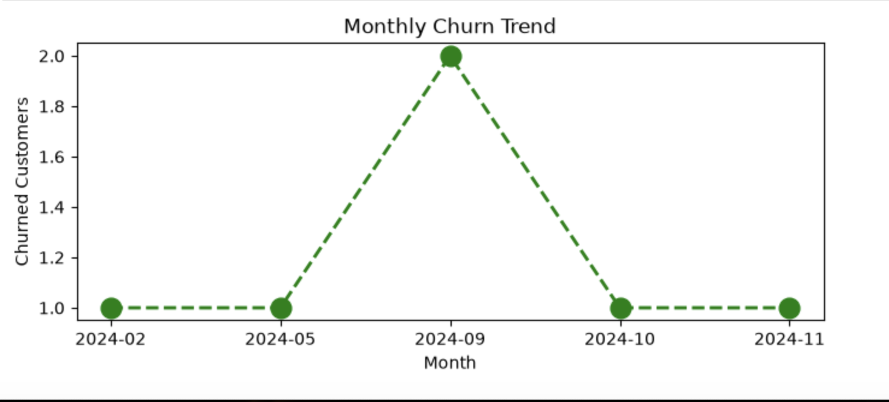
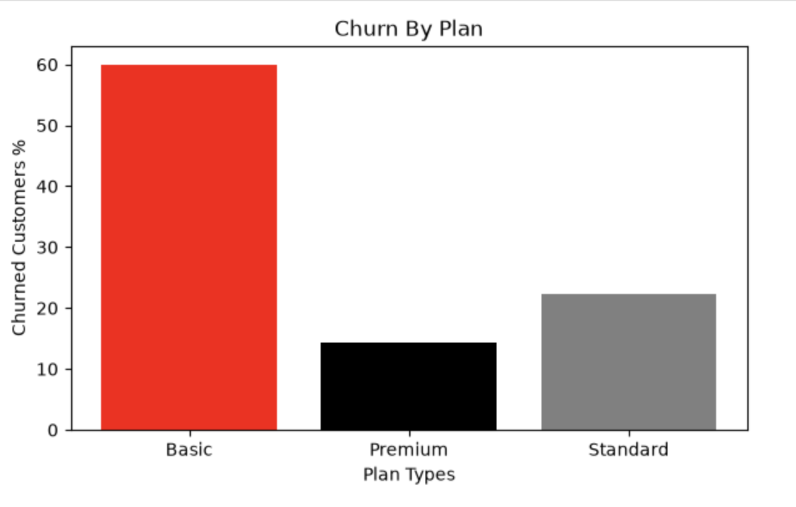
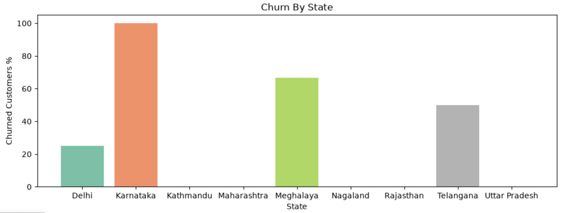
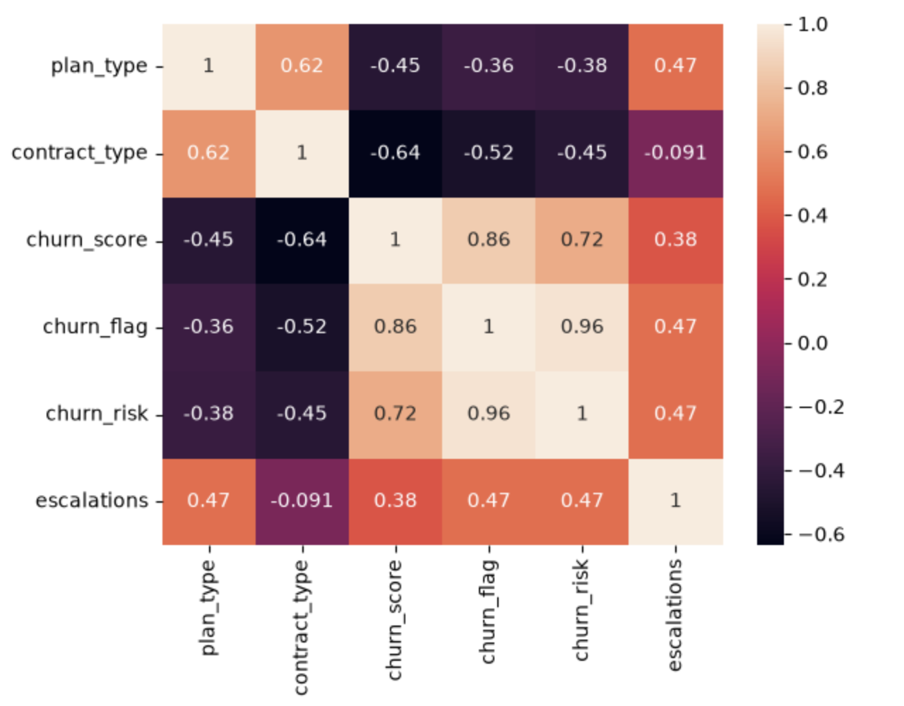

# OTT Customer Churn Analysis

An end-to-end customer churn analysis for a (sample) OTT streaming subscription business, built with **Python and SQL**. The project pulls data from a multi-table SQLite database, cleans and merges it, engineers features, calculates churn KPIs, and visualizes the results to find out **who** is churning, **why**, and **when**.

---

## Business Problem

In the highly competitive OTT market (Netflix, Hotstar, Prime Video), keeping existing subscribers is cheaper and more valuable than acquiring new ones. The goal of this project is to act as a data analyst and:

- Identify **which customers have churned** and how much revenue was lost
- Understand **which segments** (plan, contract, acquisition channel, state) churn the most
- Check whether **support escalations** are linked to churn
- Recommend **retention actions** for high-risk customers

**Churn definition used:** a customer is churned if they have a cancellation date (`cancellation_date` is not null).

---

## Dataset

SQLite database `customer_churn.db` with three related tables, joined on `customerid`:

| Table | Key columns |
|---|---|
| `db_customer` | customerid, name, country, state, gender, dob, interests, pincode |
| `db_subscription` | customerid, subscription_start_date, subscription_type, renewal_date, plan_type, contract_type, cancellation_date, cancellation_reason, monthly_charges, cltv, churn_score |
| `db_support` | customerid, complaint_date, escalations, csat_score, comment |

- 21 unique customers, 9 support tickets across 7 customers
- A raw Excel version (`customer_churn_data_raw.xlsx`) and the final merged output (`exported_churn_data.csv`) are included in this repository

---

## Tools and Libraries

- **Python:** pandas, NumPy
- **SQL:** SQLite (`sqlite3`)
- **Visualization:** Matplotlib, Seaborn
- **Environment:** Jupyter Notebook

---

## Project Workflow

1. **Connect and extract:** connected Python to the SQLite database and loaded each table into a DataFrame using SQL queries.
2. **Data cleaning:** fixed data types (dates to datetime), standardized inconsistent labels (e.g. gender), renamed and selected relevant columns, dropped irrelevant columns, handled missing values (e.g. imputed missing country from state), and ran basic quality checks.
3. **Feature engineering:**
   - `churn_flag`: 1 if the customer has a cancellation date, else 0
   - `tenure_days`: days from subscription start to cancellation (or to today if still active)
   - `complaint_count`: number of support tickets per customer
   - `churn_risk`: low / medium / high bucket based on `churn_score` (below 50, 50 to 69, 70 and above)
   - Handled duplicate support rows (kept the latest complaint per customer) before merging all three tables into one dataset
4. **Analysis (KPIs):** aggregation, group-by, and pivot tables
5. **Visualization:** line, bar, heatmap, pairplot, and catplot charts
6. **Insights and recommendations**

---

## KPIs Calculated

| KPI | Result |
|---|---|
| Churn rate | **28.57%** (6 of 21 customers) |
| Retention rate | **71.43%** |
| ARPU (avg. monthly revenue per user) | **18.85** |
| Average customer tenure | **~1,577 days** (changes with the date you run the notebook) |
| Monthly revenue lost to churned customers | **73.94** (about 18.7% of total monthly revenue of 395.79) |
| Escalation rate | **19.05%** |
| Avg. complaints per customer | **0.43** |
| Correlation: escalation vs churn | **0.47** (calculated only for customers who raised a complaint) |
| Churn by plan, contract, subscription type, and state | See below |

---

## Key Findings

**Churn by plan type**

| Plan | Churn rate | Customers |
|---|---|---|
| Basic | 60.0% | 5 |
| Standard | 22.2% | 9 |
| Premium | 14.3% | 7 |

**Churn by contract type**

| Contract | Churned | Customers | Churn rate |
|---|---|---|---|
| Monthly | 5 | 9 | 55.56% |
| Annual | 1 | 12 | 8.33% |

**Churn by acquisition channel (subscription type)**

| Channel | Churn rate | Customers |
|---|---|---|
| Organic | 0.0% | 9 |
| Paid | 16.7% | 6 |
| Referral | 83.3% | 6 |

**Other observations**

- **Basic-plan customers churn the most**, but they contribute the least revenue (52.95 of 395.79 monthly revenue), so the revenue impact is limited.
- **Monthly-contract customers churn about 6.7x more than annual ones** (55.6% vs 8.3%), which points to annual plans as a retention lever.
- **Referral-acquired customers churn at 83%**, versus 0% for organic users. This is worth investigating (quality of referral offers, onboarding, or incentive-driven sign-ups).
- **Support escalations are positively linked to churn** (correlation 0.47), suggesting that unresolved escalations push customers away.
- **Churn peaked in September 2024** (2 customers), with 1 churned customer each in Feb, May, Oct, and Nov 2024. With so few events, this is a spike to investigate rather than a clear trend.
- **Karnataka (100%), Meghalaya (66.7%), and Telangana (50%) show the highest state-level churn**, but each state has only a handful of customers, so this needs more data.
- **`churn_score` is strongly correlated with actual churn (0.86)**, which suggests the existing score is a good risk indicator. Since it is a pre-calculated field, this confirms it works rather than being an independent discovery.

---

## Visualizations

**Monthly churn trend**



**Churn by plan type**



**Churn by state**



**Correlation heatmap**



---

## Recommendations

1. **Push annual contracts:** offer discounts or perks to move monthly subscribers to annual plans.
2. **Prioritize high-risk customers:** target customers with a "high" or "medium" churn risk, ranked by customer lifetime value (CLTV), with outreach by email, SMS, or calls.
3. **Fix escalations faster:** set up a faster resolution path for escalated support tickets, since they are linked to churn.
4. **Review the referral program:** check why referred users leave so quickly.
5. **Investigate the September 2024 spike**, high-churn states, and the Basic plan for pricing or service issues, and monitor competitors.

---

## Limitations

- Small sample (21 customers), so percentages move a lot with a single customer
- Escalation correlation is based on only the 7 customers who contacted support
- This is an exploratory analysis, not a predictive model

## Future Improvements

- Build a churn prediction model (logistic regression or random forest)
- Use a larger dataset and add statistical significance tests
- Calculate CLTV at risk for active high-risk customers
- Build an interactive dashboard in Power BI or Tableau

---

## How to Run

1. Download or clone this repository.
2. Install dependencies:
   ```bash
   pip install -r requirements.txt
   ```
3. Launch Jupyter and open the notebook:
   ```bash
   jupyter notebook churn_analysis_1.ipynb
   ```

Keep `customer_churn.db` in the same folder as the notebook, since the notebook reads it from there.

---

## Repository Structure

```
ott-customer-churn-analysis/
├── README.md
├── requirements.txt
├── churn_analysis_1.ipynb
├── customer_churn.db
├── customer_churn_data_raw.xlsx
├── exported_churn_data.csv
├── monthly_churn_trend.png
├── churn_by_plan.png
├── churn_by_state.png
└── correlation_heatmap.png
```

---

## Author

**Tanish Rastogi**
[LinkedIn](https://www.linkedin.com/in/tanish-rastogi-794039283) | tanishrastogi97@gmail.com

## Acknowledgements

Project idea, dataset, and guidance from [Rishabh Mishra's](https://www.linkedin.com/in/rishabhnmishra/) data analytics tutorial.
